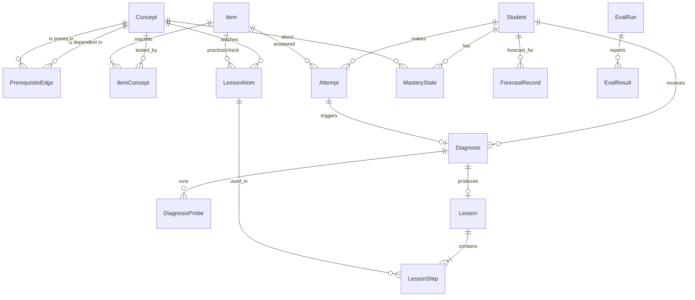
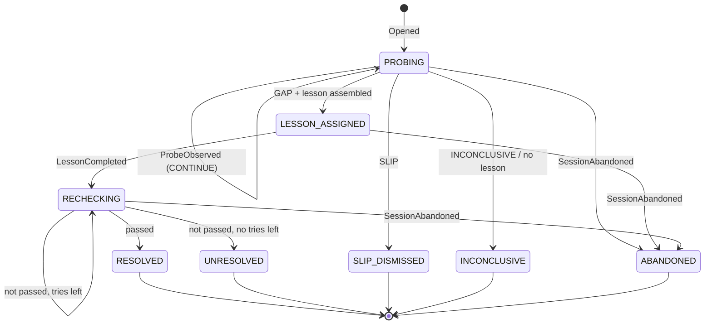

# 03 Domain & Schema

Stack-neutral. Types: `TEXT`, `INT`, `REAL` (IEEE double), `BOOL`, `TS` (UTC timestamp), `JSON`.
`Prob` = REAL clamped to `[1e-6, 1 - 1e-6]` (never exactly 0 or 1, so logs and odds stay finite).

**ID strategy (one rule, everywhere):** every primary key is opaque `TEXT`.
- Authored content (concepts, items, atoms) uses stable human-readable slugs, e.g. `frac.add.unlike`. They live in a versioned JSON seed (source of truth) and are loaded into the DB.
- Runtime rows (students, attempts, diagnoses, ...) use UUIDv4 strings.

**Reproducibility:** `curriculum_hash` = SHA-256 over the canonical (sorted, normalised) graph + items + Q-matrix + atoms. It is stored on every Diagnosis and EvalRun so any result can be tied to the exact content that produced it.

---

## Entities

### Concept (P0-1)
| Field | Type | Null | Notes |
|---|---|---|---|
| id | TEXT | no | PK, slug |
| name | TEXT | no | |
| description | TEXT | no | |
| strand | TEXT | no | e.g. `fractions`, `linear_eq` |
| tier | INT | no | rough difficulty tier, used only for deterministic tie-breaks and layout |
| p_init | Prob | no | BKT prior mastery |
| p_learn | Prob | no | BKT learn rate per opportunity |
| p_slip | Prob | no | default slip |
| p_guess | Prob | no | default guess |
| p_forget | Prob | no | per-opportunity forgetting |
| half_life_days | REAL | no | time-based forgetting half-life |

Indexes: PK only (graph is loaded into memory whole; ~50 rows).

### PrerequisiteEdge (P0-1)
| Field | Type | Null | Notes |
|---|---|---|---|
| concept_id | TEXT | no | FK Concept, ON DELETE CASCADE (the dependent) |
| prereq_id | TEXT | no | FK Concept, ON DELETE CASCADE (the prerequisite) |

PK `(concept_id, prereq_id)`. CHECK `concept_id <> prereq_id`.
Indexes: `(prereq_id)`, query served: *descendants_of(c)* (who depends on c). PK prefix serves *parents_of(c)*.
Acyclicity is not expressible as a constraint; enforced by `validate_graph` at load time.

### Item (P0-1)
| Field | Type | Null | Notes |
|---|---|---|---|
| id | TEXT | no | PK, slug |
| stem | TEXT | no | question text |
| kind | TEXT | no | `MCQ` or `NUMERIC` |
| choices | JSON | yes | list of `{id, text}`; required for MCQ |
| answer | TEXT | no | choice id, or numeric string |
| tolerance_abs | REAL | yes | NUMERIC only |
| tolerance_rel | REAL | yes | NUMERIC only |
| difficulty | REAL | no | 0..1, informational |
| p_slip | Prob | yes | override of concept default |
| p_guess | Prob | yes | override; MCQ default is `1 / len(choices)` |

### ItemConcept (Q-matrix) (P0-1)
| Field | Type | Null | Notes |
|---|---|---|---|
| item_id | TEXT | no | FK Item, CASCADE |
| concept_id | TEXT | no | FK Concept, RESTRICT |
| is_primary | BOOL | no | exactly one primary per item |

PK `(item_id, concept_id)`. Unique partial index on `(item_id) WHERE is_primary`.
Indexes: `(concept_id, item_id)`, query served: *items_for_concept(c)* for probe selection and recheck.
Semantics: an item is answered correctly with high probability only if **all** its concepts are mastered (noisy-AND).

### LessonAtom (P0-4)
| Field | Type | Null | Notes |
|---|---|---|---|
| id | TEXT | no | PK, slug |
| concept_id | TEXT | no | FK Concept, RESTRICT |
| kind | TEXT | no | `DEFINITION`, `WORKED_EXAMPLE`, `BRIDGE`, `PRACTICE`, `CHECK` |
| body | TEXT | no | authored markdown |
| est_seconds | INT | no | > 0 |
| order_hint | INT | no | order among same kind and concept |
| item_id | TEXT | yes | FK Item; required for `PRACTICE` and `CHECK` |

Indexes: `(concept_id, kind, order_hint)`, query served: *atoms_for_concept(c)* in assembly order.

### Student (P0-2)
| Field | Type | Null | Notes |
|---|---|---|---|
| id | TEXT | no | PK, UUID |
| pseudonym | TEXT | no | UNIQUE, random handle (`student-7f3a`); **no names, emails or roll numbers** |
| is_synthetic | BOOL | no | true for eval-harness students |
| created_at | TS | no | |

### Attempt (P0-2, immutable event log)
| Field | Type | Null | Notes |
|---|---|---|---|
| id | TEXT | no | PK, UUID |
| student_id | TEXT | no | FK Student, CASCADE |
| seq | INT | no | 1-based per student, gapless |
| item_id | TEXT | no | FK Item, RESTRICT |
| context | TEXT | no | `PRACTICE`, `PROBE`, `LESSON_CHECK`, `RECHECK` |
| diagnosis_id | TEXT | yes | FK Diagnosis, SET NULL; null for plain practice |
| answer_given | TEXT | no | |
| is_correct | BOOL | no | computed by `grade_answer`, never client-supplied |
| latency_ms | INT | yes | |
| attempted_at | TS | no | |

UNIQUE `(student_id, seq)`. Indexes: that unique index serves *attempt_history(student) ORDER BY seq* (replay); `(diagnosis_id)` serves *attempts_for_diagnosis*.
Insert order note: a failed PRACTICE attempt is inserted first, then the Diagnosis that points at it, then PROBE attempts that point back (hence nullable FK).

### MasteryState (P0-2, derived cache)
| Field | Type | Null | Notes |
|---|---|---|---|
| student_id | TEXT | no | FK Student, CASCADE |
| concept_id | TEXT | no | FK Concept, RESTRICT |
| p_mastery | Prob | no | |
| n_obs | INT | no | observations folded in |
| last_observed_at | TS | yes | null until first observation; drives time-based forgetting |
| updated_at | TS | no | |

PK `(student_id, concept_id)`; serves *student_mastery(student)* (full-graph heatmap).
**Invariant (testable):** replaying a student's Attempts through `update_mastery_from_attempt` reproduces this table exactly.

### Diagnosis (P0-3)
| Field | Type | Null | Notes |
|---|---|---|---|
| id | TEXT | no | PK, UUID |
| student_id | TEXT | no | FK Student, CASCADE |
| trigger_attempt_id | TEXT | no | FK Attempt, RESTRICT, UNIQUE (one diagnosis per failed attempt) |
| parent_diagnosis_id | TEXT | yes | FK Diagnosis; set when re-diagnosing after a failed recheck |
| excluded_concepts | JSON | no | concept ids ruled out by earlier diagnoses; default `[]` |
| state | TEXT | no | see state machine |
| verdict | TEXT | yes | `GAP`, `SLIP`, `INCONCLUSIVE`; null while PROBING |
| root_concept_id | TEXT | yes | FK Concept; set when verdict = GAP |
| confidence | Prob | yes | posterior of the verdict |
| posterior | JSON | no | latest map hypothesis -> probability (evidence trail) |
| trace | JSON | yes | ordered traversal path target -> root with per-node posterior |
| config_snapshot | JSON | no | thresholds and BKT defaults used |
| curriculum_hash | TEXT | no | |
| created_at / updated_at | TS | no | |
| closed_at | TS | yes | set on entering a terminal state |

Indexes: `(student_id, state)`, query served: *open_diagnosis(student)*.

### DiagnosisProbe (P0-3)
| Field | Type | Null | Notes |
|---|---|---|---|
| id | TEXT | no | PK |
| diagnosis_id | TEXT | no | FK Diagnosis, CASCADE |
| seq | INT | no | 1-based |
| item_id | TEXT | no | FK Item, RESTRICT |
| attempt_id | TEXT | yes | FK Attempt; null until answered |
| eig_bits | REAL | no | expected information gain when chosen |
| posterior_after | JSON | yes | posterior after the answer |

UNIQUE `(diagnosis_id, seq)`; serves *probes_for_diagnosis* in order.

### Lesson (P0-4)
| Field | Type | Null | Notes |
|---|---|---|---|
| id | TEXT | no | PK |
| diagnosis_id | TEXT | no | FK Diagnosis, CASCADE, UNIQUE (one lesson per diagnosis) |
| student_id | TEXT | no | FK Student, CASCADE |
| root_concept_id | TEXT | no | FK Concept |
| est_seconds | INT | no | total, <= budget |
| created_at | TS | no | |
| completed_at | TS | yes | |

### LessonStep (P0-4)
| Field | Type | Null | Notes |
|---|---|---|---|
| lesson_id | TEXT | no | FK Lesson, CASCADE |
| position | INT | no | 1-based |
| atom_id | TEXT | no | FK LessonAtom, RESTRICT |
| viewed_at | TS | yes | |

PK `(lesson_id, position)`.

### ForecastRecord (D2)
| Field | Type | Null | Notes |
|---|---|---|---|
| id | TEXT | no | PK |
| student_id | TEXT | no | FK Student, CASCADE |
| concept_id | TEXT | no | FK Concept |
| made_at_seq | INT | no | student's attempt count when forecast was made |
| p_mastery_pred | Prob | no | forecast latent mastery at the next opportunity |
| p_lo / p_hi | Prob | no | 90% interval |
| p_correct_pred | Prob | no | predicted probability the next item on this concept is correct (observable) |
| observed_correct | BOOL | yes | null until resolved |
| resolved_attempt_id | TEXT | yes | FK Attempt |

Index `(student_id, concept_id, made_at_seq)`; serves *unresolved_forecasts(student, concept)* and calibration queries.

### EvalRun / EvalResult (D1, D2)
**EvalRun:** `id` PK, `created_at` TS, `seed` INT, `n_students` INT, `config` JSON, `curriculum_hash` TEXT, `code_version` TEXT null. Index `(created_at DESC)` serves *latest_eval_run*.
**EvalResult:** `run_id` FK EvalRun CASCADE, `method` TEXT (`graph_bayes`, `baseline_parent`, `baseline_flat_bkt`), `metric` TEXT (`top1`, `top3`, `probes_mean`, `auc`, `brier`, `reliability`), `value` REAL, `n` INT, `detail` JSON null (reliability bins). PK `(run_id, method, metric)`.

---

## ER diagram

---

## State machine: Diagnosis (P0-3, P0-4, P0-5)

| From | Event | Guard | To |
|---|---|---|---|
| (new) | `Opened` | triggering attempt is incorrect | PROBING |
| PROBING | `ProbeObserved` | verdict kind = CONTINUE | PROBING |
| PROBING | `ProbeObserved` | verdict kind = GAP and lesson assembled | LESSON_ASSIGNED |
| PROBING | `ProbeObserved` | verdict kind = GAP and lesson could not be assembled | INCONCLUSIVE |
| PROBING | `ProbeObserved` | verdict kind = SLIP | SLIP_DISMISSED |
| PROBING | `ProbeObserved` | verdict kind = INCONCLUSIVE | INCONCLUSIVE |
| LESSON_ASSIGNED | `LessonCompleted` | every LessonStep viewed | RECHECKING |
| RECHECKING | `RecheckObserved` | passed (see `recheck_passed`) | RESOLVED |
| RECHECKING | `RecheckObserved` | not passed and rechecks used < `max_rechecks` | RECHECKING |
| RECHECKING | `RecheckObserved` | not passed and rechecks used >= `max_rechecks` | UNRESOLVED |
| PROBING, LESSON_ASSIGNED, RECHECKING | `SessionAbandoned` | none | ABANDONED |

Terminal: RESOLVED, UNRESOLVED, SLIP_DISMISSED, INCONCLUSIVE, ABANDONED.
Illegal (must return `IllegalTransitionError`): any event from a terminal state; PROBING to RECHECKING; LESSON_ASSIGNED to PROBING or RESOLVED; RECHECKING back to LESSON_ASSIGNED; `LessonCompleted` before all steps are viewed.
A second lesson only ever comes from a **new** Diagnosis (UNRESOLVED hands off by creating one with `parent_diagnosis_id` set and the old root in `excluded_concepts`).

---

## Domain function contracts (implemented in Step 5B, tested in Step 7)

Global rules: no I/O, no DB, no clock, no env reads. Time enters as parameters (`elapsed_days`, `now`). Randomness enters only as an explicit `rng` argument (seeded PRNG), used **only** by the simulator. Iterate in sorted-id order; every argmax/argmin breaks ties by ascending id. Every returned `Prob` is passed through `clamp_prob`.

**Domain errors (named types):** `GraphCycleError(path)`, `UnknownConceptError(id)`, `QMatrixError(msg)`, `InvalidAnswerError`, `InvalidProbabilityError`, `IllegalTransitionError(state, event)`, `EmptyCandidateSetError`, `NoContentError(concept_id)`, `LessonBudgetError`.

**Config (`DomainConfig`, defaults, pinned in Step 4):** `theta_master=0.85`, `tau_conf=0.80`, `min_probes=1`, `max_probes=4`, `max_rechecks=3`, `lesson_budget_seconds=300`, `min_checks=2`, `eps=1e-6`, BKT defaults `p_init=0.30, p_learn=0.15, p_slip=0.10, p_guess=0.20, p_forget=0.02`.

### Graph and content (P0-1)
- `validate_graph(concepts, edges) -> Graph | GraphCycleError | UnknownConceptError`: rejects cycles (reports one cycle path), self-loops, duplicate edges, dangling ids.
- `validate_qmatrix(graph, items, item_concepts) -> None | QMatrixError`: every item has >= 1 concept and exactly one primary; MCQ has choices and an answer among them; NUMERIC has a parseable answer.
- `coverage_report(graph, items, item_concepts) -> {concept_id: n_items}`: seed gate requires >= 3 per concept.
- `topological_order(graph) -> list[ConceptId]`: prerequisites first; ties by `(tier, id)`.
- `parents(graph, c)`, `children(graph, c)`, `ancestors(graph, c) -> dict[ConceptId, int]` (min edge distance), `descendants(graph, c) -> dict[ConceptId, int]`. Never include `c` itself.
- `curriculum_hash(graph, items, item_concepts, atoms) -> str`: canonical SHA-256, independent of input order.

### Grading
- `grade_answer(item, given: str) -> bool`: MCQ exact choice-id match; NUMERIC within `tolerance_abs` or `tolerance_rel` (either satisfied). Malformed input (unparseable number, unknown choice id) raises `InvalidAnswerError`; it is **not** recorded as an attempt.

### Knowledge-state tracking (P0-2)
- `clamp_prob(x: float, eps) -> Prob`; raises `InvalidProbabilityError` on NaN.
- `effective_item_params(item, concepts_of_item) -> (slip, guess)`: item override, else concept mean for slip; guess = override, else `1/len(choices)` for MCQ, else concept mean.
- `bkt_posterior(p: Prob, correct: bool, slip, guess) -> Prob`: correct: `p(1-s) / (p(1-s) + (1-p)g)`; incorrect: `p·s / (p·s + (1-p)(1-g))`.
- `bkt_transition(p: Prob, learn, forget) -> Prob`: `p(1-forget) + (1-p)·learn`.
- `apply_time_forgetting(p, elapsed_days, half_life_days, floor) -> Prob`: `floor + (p - floor)·0.5^(elapsed/half_life)`; `elapsed_days = 0` returns `p`.
- `item_success_probability(item, mastery: Map[ConceptId, Prob]) -> Prob`: noisy-AND, `P = Π p_c · (1-s) + (1 - Π p_c) · g`. Used for prediction (D2, D1 AUC).
- `update_mastery_from_attempt(mastery, item, concepts_of_item, correct) -> Map[ConceptId, Prob]`: exact marginal posterior per required concept `c` under independent priors. With `q = Π_{k≠c} p_k`:
  - correct: `P(c | correct) = p_c·[q(1-s) + (1-q)g] / ( p_c·[q(1-s) + (1-q)g] + (1-p_c)·g )`
  - incorrect: `P(c | wrong) = p_c·[q·s + (1-q)(1-g)] / ( p_c·[q·s + (1-q)(1-g)] + (1-p_c)(1-g) )`
  then `bkt_transition` on each. Single-concept items reduce to `bkt_posterior`. Concepts not in the item are returned unchanged. Invariants: outputs in `[eps, 1-eps]`; a correct answer never lowers any required concept; a wrong answer never raises one.
- `replay_attempts(initial_mastery, attempts, items, item_concepts) -> Map[ConceptId, Prob]`: folds attempts in `seq` order; must equal stored MasteryState.

### Root-cause diagnosis (P0-3)
Model: **single-root-gap hypotheses.** Hypothesis `h_c` = "the student lacks concept `c` and therefore everything downstream of it, and masters the rest". Plus `SLIP` = "everything is mastered; the failure was a slip". Under `h_c`, an item is *affected* if any of its required concepts is `c` or a descendant of `c`: affected items are correct with probability `guess`, unaffected with `1 - slip`. Multiple simultaneous gaps are handled sequentially (resolve, recheck, re-diagnose).
- `candidate_set(graph, required_concepts, excluded) -> list[ConceptId]`: required concepts plus all their ancestors, minus `excluded`, topological order. Raises `EmptyCandidateSetError` if empty.
- `prior_over_hypotheses(graph, mastery, candidates) -> Map[Hypothesis, Prob]`: `π(c) ∝ (1 - p_c) · Π_{a ∈ parents(c)} p_a` (c unmastered while its direct prerequisites are mastered, i.e. a *frontier* gap); `π(SLIP) ∝ Π_{k ∈ candidates} p_k`. Normalised to sum 1.
- `is_affected(graph, item_concepts, c) -> bool`.
- `observation_likelihood(graph, hypothesis, item, item_concepts, correct) -> Prob`: per the model above (SLIP is never affected).
- `posterior_update(graph, post, item, item_concepts, correct) -> Map[Hypothesis, Prob]`: Bayes, renormalised. The triggering failed attempt is folded in first, then each probe.
- `expected_information_gain(graph, post, item, item_concepts) -> float`: bits; `H(post) - Σ_o P(o)·H(post | o)`; always >= 0.
- `select_next_probe(graph, items, item_concepts, post, asked_item_ids) -> Item | None`: argmax EIG over unasked items touching the candidate set; excludes the trigger item; ties by item id; `None` if no eligible item.
- `diagnosis_verdict(post, probes_used, cfg) -> Verdict`: `Verdict = Continue | Gap(concept, confidence, ranked_top3) | Slip(confidence) | Inconclusive(ranked_top3)`. Rules: if `probes_used < min_probes` then `Continue`; else if best hypothesis has `P >= tau_conf` then `Gap` or `Slip` accordingly; else if `probes_used >= max_probes` or no probe available then `Inconclusive`; else `Continue`.
- `explain_diagnosis(graph, post, target, root) -> Trace`: ordered nodes on the shortest path `root -> target`, each with its posterior mass and mastery; this is the structure the UI renders.
- `run_diagnosis_episode(graph, items, item_concepts, mastery, failed_attempt, responder: Item -> bool, cfg, excluded) -> EpisodeResult`: pure orchestration loop (open, probe, update, verdict) driven by an injected `responder`; used by the service layer and the eval harness. Returns verdict, probes used, final posterior, trace.

### Lesson assembly (P0-4)
- `bridge_concepts(graph, root, targets) -> list[ConceptId]`: `{root} ∪ (descendants(root) ∩ ancestors(targets)) ∪ targets`, topological order.
- `lesson_est_seconds(atoms) -> int`: sum of `est_seconds`.
- `assemble_lesson(graph, atoms, items, item_concepts, mastery, root, targets, cfg) -> Lesson | NoContentError | LessonBudgetError`:
  1. Keep only concepts from `bridge_concepts` with `p_mastery < theta_master` (root always kept).
  2. Per kept concept in topological order choose atoms in kind order `DEFINITION, WORKED_EXAMPLE, (BRIDGE), PRACTICE, CHECK`, by `order_hint` then id. Root gets the full sequence; intermediate concepts get `DEFINITION` + `WORKED_EXAMPLE` (+ `BRIDGE` if present) only.
  3. Reserve at least `min_checks` `CHECK` atoms on the root; if total exceeds `lesson_budget_seconds`, drop intermediate concepts farthest from the root first, then optional atoms, never the reserved checks.
  4. If a concept has no atoms, fall back to practice items from the item bank for that concept; if that is also empty, `NoContentError`.
  5. Deterministic: same inputs give the same ordered atom list.
  Invariants: every step's concept is in the kept set; order is topological; `est_seconds <= budget`; ends with >= `min_checks` root checks.
- `recheck_passed(p_root: Prob, correct_streak: int, cfg) -> bool`: `p_root >= theta_master` and `correct_streak >= 2`.

### State transitions (P0-3, P0-4)
- `diagnosis_transition(state, event) -> DiagnosisState | IllegalTransitionError`: pure table lookup. Events carry precomputed guard facts (`verdict_kind`, `lesson_assembled`, `all_steps_viewed`, `passed`, `rechecks_used`, `max_rechecks`), so the function never reads a DB or clock.

### Trajectory forecasting (D2)
- `forecast_mastery(p0: Prob, learn, forget, n: int) -> Prob`: closed form of the two-state chain, `p* + (p0 - p*)·(1 - learn - forget)^n` with `p* = learn / (learn + forget)`. `n = 0` returns `p0`; monotone toward `p*`.
- `time_to_mastery(p0, learn, forget, theta, max_steps) -> int | None`: smallest `n` with forecast >= `theta`; `None` if `p* < theta` or not reached in `max_steps` (reported as "not reachable at the current rate").
- `forecast_interval(p_mean: Prob, n_eff: float, level=0.90) -> (Prob, Prob)`: Beta approximation with `a = p·n_eff`, `b = (1-p)·n_eff`, quantiles by bisection on the regularised incomplete beta (deterministic, no randomness). `n_eff = k0 + n_obs`.
- `predict_next_correct(item, mastery) -> Prob`: alias of `item_success_probability` for forecast records.

### Evaluation (D1, D2)
- `generate_true_state(graph, root_gaps: set[ConceptId]) -> Map[ConceptId, bool]`: mastered iff not in `root_gaps ∪ descendants(root_gaps)`.
- `simulate_response(item, item_concepts, true_state, rng) -> bool`: correct with `1 - slip` if all required concepts mastered, else `guess` (uses `rng`, the only randomness in the domain layer).
- `baseline_blame_parent(graph, mastery, failed_item_concepts) -> ConceptId`: lowest-mastery **direct** prerequisite of the primary concept.
- `baseline_flat_bkt_predict(item, item_concepts, mastery_flat) -> Prob`: prediction with no graph coupling.
- `top_k_accuracy(predictions: list[list[ConceptId]], truths: list[ConceptId], k) -> float`.
- `brier_score(pred: list[Prob], obs: list[bool]) -> float`; `auc(pred, obs) -> float` (0.5 when only one class present); `reliability_bins(pred, obs, n_bins) -> list[{p_pred_mean, p_obs_mean, count}]`.

---

## Traceability
| Feature / differentiator | Entities | Functions |
|---|---|---|
| P0-1 Curriculum knowledge graph | Concept, PrerequisiteEdge, Item, ItemConcept | `validate_graph`, `validate_qmatrix`, `coverage_report`, `topological_order`, `parents`, `children`, `ancestors`, `descendants`, `curriculum_hash`, `grade_answer` |
| P0-2 Knowledge-state tracker | Student, Attempt, MasteryState | `clamp_prob`, `effective_item_params`, `bkt_posterior`, `bkt_transition`, `apply_time_forgetting`, `item_success_probability`, `update_mastery_from_attempt`, `replay_attempts` |
| P0-3 Root-cause diagnosis | Diagnosis, DiagnosisProbe | `candidate_set`, `prior_over_hypotheses`, `is_affected`, `observation_likelihood`, `posterior_update`, `expected_information_gain`, `select_next_probe`, `diagnosis_verdict`, `explain_diagnosis`, `run_diagnosis_episode`, `diagnosis_transition` |
| P0-4 Micro-lesson assembler | LessonAtom, Lesson, LessonStep | `bridge_concepts`, `assemble_lesson`, `lesson_est_seconds`, `recheck_passed`, `diagnosis_transition` |
| P0-5 Learner session UI | All of the above (read model: MasteryState, Diagnosis.trace, Lesson, LessonStep) | `explain_diagnosis`, `item_success_probability`, plus service-layer composition (Step 5D) |
| D1 Synthetic-student eval harness | EvalRun, EvalResult, Student (`is_synthetic`) | `generate_true_state`, `simulate_response`, `run_diagnosis_episode`, `baseline_blame_parent`, `baseline_flat_bkt_predict`, `top_k_accuracy`, `auc`, `brier_score` |
| D2 Trajectory forecast + calibration | ForecastRecord, EvalResult | `forecast_mastery`, `time_to_mastery`, `forecast_interval`, `predict_next_correct`, `brier_score`, `reliability_bins` |
| D3 Deterministic core, model optional | (none; optional rephraser validates against LessonStep concept ids) | every function above is pure; rephrase guard is specified in Step 5C |

---

## Addendum (Step 5B, 2026-11-01): refinements made while implementing

Signatures were adapted to what a pure function can actually receive; behaviour is unchanged unless listed under "Corrections".

**Value objects** live in `domain/types.py` (`ConceptSpec`, `ItemSpec`, `QRow`, `AtomSpec`, `Graph` with precomputed `anc`/`desc` closures, outcome and plan types). `validate_graph(concepts, edges)` returns the `Graph`; edges are `(concept_id, prereq_id)`.

**Signature refinements**
- `effective_item_params(item, concept_specs)`, `item_success_probability(concept_ids, mastery, slip, guess)`, `update_mastery_from_attempt(mastery, item, concept_ids, specs, correct)`: slip/guess are passed in or derived from concept specs, since the function holds no DB.
- `observation_likelihood`, `posterior_update`, `expected_information_gain` take `item_concepts, slip, guess` instead of an item object.
- `diagnosis_verdict(post, probes_used, cfg, probe_available=True)`: the extra flag lets "no useful probe left" yield `Inconclusive`.
- `explain_diagnosis(graph, post, mastery, target, root)`; `run_diagnosis_episode(..., failed_item_id, responder, cfg, excluded)` takes `mastery` as the state **before** the failed attempt (the failure enters through the posterior, so it is not counted twice).
- `baseline_blame_parent(graph, mastery, primary_concept)`; `baseline_flat_bkt_predict(primary_concept, mastery_flat, slip, guess)` plus `flat_bkt_update` (classic single-skill BKT).
- `simulate_response(..., rng, *, slip=None, guess=None)`: optional overrides let the eval test a *mismatched* student.
- Added: `multi_concept_evidence` (evidence step alone), `parse_number`, `beta_cdf`, `beta_quantile`, `GraphStructureError`, `InvalidParameterError`, `NoPathError`.
- `AtomSpec`/`ItemSpec` fields are those the pure layer needs (no free text beyond `body` for hashing).

**Corrections to the Step 3 text**
1. *Monotonicity.* "A correct answer never lowers any required concept" is only true for the **evidence step**. After the learn/forget transition a very high mastery can drift down slightly. The invariant is now: for the same prior, the outcome after a correct answer is >= the outcome after a wrong one, for every required concept.
2. *Reserved id.* `SLIP` is reserved; no concept may use it.
3. *Lesson order.* Root core (definition, worked example, bridge, practice), then unmastered intermediates in topological order, then the root's checks **last**. First appearance of each concept follows topological order. This is what makes "ends with >= `min_checks` root checks" true.
4. *Fallback.* If a concept has no authored atoms, item-bank items stand in; reserved root checks are filled **first** so practice items cannot starve them. Fallback steps have `atom_id = None` and an `item_id`. **Consequence for Step 5D:** `LessonStep.atom_id` must become nullable and gain an `item_id` column (or the seed gate must guarantee atoms for every concept).
5. *Recheck counter.* `rechecks_used` in `RecheckObserved` counts the current recheck.
6. *Time decay.* Applied on read, never stored, so replaying attempts reproduces `MasteryState` exactly.
