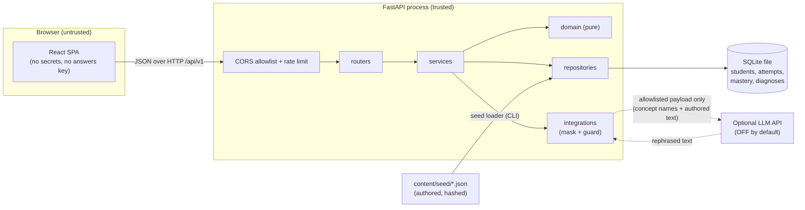

# 04 Architecture (FROZEN on confirmation)

Versions below were looked up on 2026-10-31 and verified to resolve together (`uv pip compile` for Python, `npm install --package-lock-only --strict-peer-deps` for Node). Python 3.13.18, Node 22.23.4, npm 10.9.9 and uv are available in the build environment.

## Stack
| Dimension | Choice | Why (requirement it serves) |
|---|---|---|
| Backend language | Python `>=3.11` (built and tested on 3.13), FastAPI + Pydantic v2 | The deterministic core is probability and graph numerics plus a simulation/eval harness (P0-2, P0-3, D1, D2); Python keeps that and the API in one language |
| Numerics | Python stdlib `math` only. No numpy/scipy in `domain/` | Hard limits: pure, offline, reproducible. The Beta-quantile routine in D2 is a small own implementation (bisection), so the purity checker and float behaviour stay simple |
| ORM | SQLModel on SQLAlchemy 2.1 | Maps the 15 Step 3 entities to tables and Pydantic read models without hand-written SQL |
| Database engine | SQLite (WAL mode), file at `./data/knowtrace.db` | Hard limits: offline, zero paid services, no accounts. Single-learner demo. Models avoid Postgres-only types, so `DATABASE_URL` can later point at Postgres |
| Frontend language | TypeScript 5.9.3, `strict` plus `noUncheckedIndexedAccess` | Types generated from the backend OpenAPI schema keep the UI honest about diagnosis and lesson payloads |
| Frontend framework | React 19 + Vite 8 (SPA) | No SEO or SSR requirement in Steps 1 to 3, so Next.js is not needed |
| Styling / UI | Tailwind CSS 4 + Lucide icons, hand-written primitives (`clsx` + `tailwind-merge`) | Low boilerplate, no runtime CSS framework; responsive enough for phone browsers (Step 1) |
| Graph visualisation | `@xyflow/react` + `@dagrejs/dagre` | P0-5 heatmap needs a pannable prerequisite DAG with a deterministic layered layout |
| Charts | Recharts | D2 forecast band and reliability diagram; D1 eval table panel |
| Server state / routing | TanStack Query, React Router | Typed data hooks (Step 6A) and a small multi-page shell (Step 6B) |
| API typing | `openapi-typescript` + `openapi-fetch`, generated from the exported OpenAPI file | Single source of truth for request/response types |
| Testing | pytest + Hypothesis + pytest-cov; Vitest + Testing Library + MSW | Hypothesis property tests check the Step 3 invariants (probabilities in range, replay equals cache, monotone updates); Vitest covers the UI smoke test for P0-5 |
| Lint / types / format | Ruff (lint + format), `mypy --strict`, `import-linter`; ESLint + typescript-eslint, `tsc --noEmit`, Prettier | `import-linter` mechanically enforces the layering below |
| Tooling | `uv` (Python env + lockfile), `npm` (Node), `Makefile` for tasks | Fewest moving parts; both are available in the environment |
| Optional model SDK | `anthropic` as an optional extra (`.[llm]`) | D3 only. Off by default; never imported unless enabled |

## Layering
```
routers ──► services ──► domain          (pure functions + frozen dataclasses, stdlib only)
                │  └────► repositories ──► models   (SQLModel tables)
                └───────► integrations              (rephraser, payload masking, LLM client)
cli (seed, run_eval, export_openapi) ──► services
```
Rules (arrows never point backwards; enforced by `import-linter` contracts in `backend/pyproject.toml`):
1. `routers` import only `services`, `schemas`, `core.deps`. They never import `models`, `repositories`, `sqlmodel` or `sqlalchemy`.
2. `services` orchestrate: load rows through `repositories`, map to domain types (`services/mappers.py`), call `domain`, persist results. They are the only layer that sees both ORM rows and domain objects.
3. `repositories` import `models` and SQLModel only. No business rules.
4. `domain` imports only the standard library and itself: no FastAPI, Pydantic, SQLModel, httpx, `os`, clock or global randomness. Time and `rng` arrive as parameters (Step 3 rule). The Step 5B purity checker verifies this.
5. `integrations` import `domain` types and third-party clients only; never `models`, `repositories` or `services`.
6. Domain errors are mapped to HTTP status codes in one place (`routers/errors.py`): `IllegalTransitionError` to 409, `InvalidAnswerError` to 422, `UnknownConceptError` to 404, `NoContentError` to 500 with a safe message, others to 400.

Where the Step 3 pieces live: pure contracts go in `domain/` (Step 5B). LLM wrapper, caches, payload masking and fallback routing go in `integrations/` (Step 5C). Routers and request/response schemas are Step 5D.

## Data flow & trust boundaries

Trust boundaries: (1) browser to server, where all input is validated and grading happens server-side; (2) server to the optional LLM API, crossed only by an allowlisted payload and only when explicitly enabled.

## Security & masking
- **No accounts, no PII.** A learner is a server-issued pseudonym plus UUID, kept in browser `localStorage`. The UI has no name or email field. Known limitation: anyone holding a student UUID can read that student's data. Acceptable for a local or demo deployment; the decisions log records this.
- **Server-side grading.** `is_correct` is computed by `grade_answer`; the client never supplies it. Item response schemas omit `answer`, tolerance and slip/guess fields, so the answer key never reaches the browser before submission.
- **Validation.** All request bodies are Pydantic models with length limits; malformed answers raise `InvalidAnswerError` and are not stored as attempts.
- **CORS and rate limiting.** Origin allowlist from `CORS_ORIGINS` (no wildcard, no credentials, methods GET/POST/OPTIONS). In-process per-client token bucket (`RATE_LIMIT_PER_MINUTE`), implemented in `core/ratelimit.py` with no extra dependency.
- **Secrets.** Only in a gitignored `.env`, loaded by `pydantic-settings`. `ANTHROPIC_API_KEY` is optional, never logged and never sent to the browser. The frontend reads only `VITE_API_BASE_URL`, which is public by design.
- **LLM masking pipeline (D3).** `integrations/payload_mask.py` builds every outbound payload from an allowlist: concept names, authored atom text and a target reading level. Student id, pseudonym, answers and mastery numbers are never included; a test asserts the payload keys are a subset of the allowlist. The reply goes through an output guard: it must not name any concept outside the selected lesson concepts and must stay within a length ratio of the original. Any failure, timeout or guard rejection falls back to the authored text. The model is used only if `DETERMINISTIC_ONLY=false` **and** `LLM_REPHRASE_ENABLED=true` **and** a key is present.
- **Logging.** Structured logs with ids and verdicts only; no answer text, no secrets.

## Folder structure
```
.
├── .env.example
├── .gitignore                      # .env, data/, node_modules/, .venv/, dist/
├── Makefile                        # setup, dev-api, dev-web, test, lint, types, eval, seed
├── data/                           # SQLite file (gitignored)
├── docs/pipeline/                  # 01..04 + STATUS.md
├── backend/
│   ├── pyproject.toml              # deps, extras [llm], ruff, mypy, pytest, import-linter contracts
│   ├── requirements.lock           # uv-compiled lock, committed
│   ├── content/seed/
│   │   ├── concepts.json
│   │   ├── edges.json
│   │   ├── items.json
│   │   ├── item_concepts.json
│   │   └── atoms.json
│   ├── openapi.json                # exported by cli/export_openapi.py
│   ├── src/knowtrace/
│   │   ├── main.py                 # app factory, middleware, router mounting
│   │   ├── core/                   # settings.py, db.py, deps.py, ratelimit.py, logging.py
│   │   ├── domain/                 # pure: types.py, errors.py, config.py, graph.py, grading.py,
│   │   │                           #       bkt.py, diagnosis.py, lesson.py, state_machine.py,
│   │   │                           #       forecast.py, evalkit.py, hashing.py
│   │   ├── models/                 # SQLModel tables (one file per Step 3 entity group)
│   │   ├── repositories/           # query functions per aggregate
│   │   ├── services/               # curriculum, student, attempt, diagnosis, lesson,
│   │   │                           # forecast, eval, mappers.py
│   │   ├── integrations/           # payload_mask.py, llm_client.py, rephraser.py, fallback.py
│   │   ├── schemas/                # Pydantic request/response models
│   │   ├── routers/                # curriculum, students, attempts, diagnoses, lessons,
│   │   │                           # forecasts, eval, errors.py
│   │   └── cli/                    # seed.py, run_eval.py, export_openapi.py
│   └── tests/
│       ├── domain/                 # unit + Hypothesis property tests (zero network, zero DB)
│       ├── services/
│       ├── api/                    # FastAPI TestClient end-to-end flow
│       └── eval/                   # eval-harness smoke + determinism tests
└── frontend/
    ├── package.json
    ├── package-lock.json
    ├── tsconfig.json               # strict, noUncheckedIndexedAccess
    ├── vite.config.ts
    ├── eslint.config.js
    ├── index.html
    └── src/
        ├── main.tsx
        ├── index.css               # @import "tailwindcss";
        ├── api/                    # schema.d.ts (generated), client.ts, hooks.ts
        ├── lib/                    # cn.ts, format.ts, studentId.ts
        ├── components/ui/          # Button, Card, Badge, Progress, Banner, Skeleton
        ├── features/
        │   ├── session/            # question card, answer submit
        │   ├── graph/              # knowledge-graph heatmap (React Flow + dagre)
        │   ├── diagnosis/          # trace view, probe flow
        │   ├── lesson/             # lesson player, recheck
        │   ├── forecast/           # trajectory sparkline + band
        │   └── eval/               # D1/D2 results panel
        ├── pages/                  # Practice, Graph, Evaluation
        └── test/                   # setup.ts, msw handlers, smoke test
```

## Environment variables
See `.env.example` at the repo root. Groups: app and CORS, data, domain thresholds (defaults equal Step 3's `DomainConfig`), determinism and model flags, eval seed, and the one public frontend variable.

## Pinned dependencies

**Python (`backend/pyproject.toml`; verified together)**
| Package | Version | Role |
|---|---|---|
| fastapi | 0.162.0 | API framework |
| uvicorn | 0.54.0 | ASGI server |
| pydantic | 2.14.2 | schemas |
| pydantic-settings | 2.16.2 | env loading |
| sqlmodel | 0.0.48 | ORM (requires SQLAlchemy `>=2.0.14,<2.2`) |
| sqlalchemy | 2.1.6 | ORM core |
| anthropic (extra `llm`) | 2.3.0 | optional D3 rephraser |
| pytest | 9.2.0 | tests |
| pytest-cov | 7.1.0 | coverage |
| hypothesis | 6.170.14 | property tests |
| httpx | 0.28.1 | FastAPI TestClient transport |
| ruff | 0.17.3 | lint + format |
| mypy | 2.4.1 | `--strict` type check |
| import-linter | 2.15 | layering contracts |

**Node (`frontend/package.json`; verified with `--strict-peer-deps`)**
| Package | Version | Role |
|---|---|---|
| react / react-dom | 19.3.1 | UI |
| react-router-dom | 7.18.5 | routing |
| @tanstack/react-query | 5.105.0 | server state |
| openapi-fetch | 0.17.0 | typed client |
| @xyflow/react | 12.12.0 | graph canvas |
| @dagrejs/dagre | 3.1.3 | graph layout |
| recharts | 3.10.1 | charts |
| lucide-react | 1.66.0 | icons |
| clsx / tailwind-merge | 2.1.1 / 3.7.0 | class utilities |
| vite | 8.3.5 | build/dev server |
| @vitejs/plugin-react | 6.1.2 | React plugin (requires Vite 8) |
| typescript | **5.9.3** | see decisions log (not 7.x) |
| tailwindcss / @tailwindcss/vite | 4.3.3 | styling |
| openapi-typescript | 7.13.0 | schema type generation |
| vitest / @vitest/coverage-v8 | 5.0.5 | tests |
| jsdom | 30.1.3 | test DOM |
| msw | 3.0.3 | API mocking in UI tests |
| @testing-library/react | 16.3.3 | component tests |
| @testing-library/jest-dom | 7.0.1 | matchers |
| @testing-library/user-event | 14.6.8 | interactions |
| eslint | 10.14.0 | lint |
| typescript-eslint | 8.72.1 | TS lint rules |
| eslint-plugin-react-hooks | 7.1.1 | hooks lint |
| prettier | 3.9.10 | format |
| @types/react / @types/react-dom | 19.3.0 | types |
| @types/node | 22.20.5 | matches Node 22 runtime |

Lockfiles (`backend/requirements.lock`, `frontend/package-lock.json`) are generated in Steps 5A and 6A from exactly these pins and committed.

## Decisions log
- **Python + FastAPI over TypeScript on Node**: the core is probability, graph traversal and a simulation harness. Cost: two languages; mitigated by generating TS types from OpenAPI.
- **stdlib `math` only in `domain/`, no numpy/scipy**: keeps the layer pure, offline and bit-reproducible, and keeps the purity checker trivial. Cost: slower eval loops and a hand-written Beta quantile; fine at about 50 concepts and a few hundred synthetic students.
- **SQLite over Postgres**: offline, zero setup, single learner. Cost: no concurrent multi-user writes; revisit only if the app is hosted for many users.
- **No Alembic migrations**: content is seeded from JSON and tied to `curriculum_hash`; during the build the DB is recreated and reseeded on schema change. Revisit if real user data ever needs to persist across schema versions.
- **TypeScript 5.9.3 instead of 7.0.2 (latest)**: `typescript-eslint` 8.72.1 requires TypeScript below 6.1, and `openapi-typescript` 7.13.0 requires 5.x. Upgrade only when both support it.
- **Vitest + Testing Library + MSW instead of Playwright for the UI smoke test**: no browser download, runs anywhere, still exercises the fail, diagnose, lesson, recheck flow against mocked API responses. A real-browser run can be added later.
- **React Flow and Recharts over hand-rolled SVG**: more weight, but pan/zoom DAG and interval charts are core to the demo. Accepted.
- **Next.js rejected**: no SEO or SSR requirement. **Redis, queues, auth rejected**: single learner, no PII, no async workloads.
- **Domain dataclasses separate from SQLModel tables**: keeps `domain/` dependency-free and mechanically checkable. Cost: mapper code in `services/mappers.py`.
- **LLM off by default and optional**: `DETERMINISTIC_ONLY=true` ships as the default, so the app and all tests need no key or network.
- **`npm audit` reports 12 moderate findings**, all in dev-time tooling (ESLint, typescript-eslint, openapi-typescript via a `minimatch` denial-of-service advisory). None ship in the browser bundle. Accepted; re-check before any public release.
- **No auth means UUID-as-capability**: acceptable for a local demo; add real auth before any public hosting.
- **(5C) `anthropic` 2.3.0 brings its own HTTP stack, `httpx2` 2.16.0** (already in `requirements.lock`), and rejects plain `httpx` clients at runtime. `AnthropicClient` therefore types `http_client` as `httpx2.Client`, imports it only under `TYPE_CHECKING`, and the HTTP-level tests use `httpx2.MockTransport`. `httpx` 0.28.1 stays for FastAPI's `TestClient`. Neither is imported unless the model path is enabled.
- **(5C) Cache is in-process only** (TTL 24 h, 512 entries, keyed on masked input + prompt version + model id). Not shared across workers or restarts; acceptable because every miss falls back to authored text. No cache env vars were added, so `.env.example` and `Settings` stay in sync.
- **(5C) import-linter contracts added** for the domain-purity, integrations and models boundaries; `tests/test_architecture.py` runs them with the suite.
- **(5D) OpenAPI export path is `docs/openapi.json`** (not `backend/openapi.json` as drawn above), because Step 6A generates from `docs/`. `python -m knowtrace.cli.export_openapi` rewrites it; a test fails if it is stale.
- **(5D) Services return plain dataclasses ("views")**; routers validate them into response schemas, so ORM rows never reach the API. Item payloads never contain the answer key.
- **(5D) Server decides the next question**: probe and recheck answers carry only `answer` (and optional latency), so a client cannot pick an easier probe or claim correctness.
- **(5D) One open diagnosis per student**: a new practice attempt returns 409 until the diagnosis finishes or is abandoned.
- **(5D) Mastery shown to the learner decays on read** (toward the concept prior); stored mastery and the diagnosis use undecayed values.
- **(5D) Forecast records (D2) are written automatically**: each attempt scores the previous forecast for the touched concepts and records a new one.
- **(5D) `LessonStep`** now carries `concept_id`, `kind`, `est_seconds`, nullable `atom_id` and nullable `item_id` (CHECK: at least one), so item-bank fallback steps are storable.
- **(5D) Layering contracts added**: routers cannot import models, repositories, integrations or SQL libraries; repositories sit below services; services know nothing about HTTP.
- **(5D) Known limits**: in-process rate limiter (per worker); `GET /students/{id}/diagnoses` returns a plain list without a total; UUID-as-capability, no auth (as frozen in Step 4).
- **(6A) Frontend API seam lives in `src/api/`** (as drawn in the folder tree), not `src/types`, `src/lib`, `src/hooks` as the skill's examples suggest. Generated file is `schema.d.ts`; aliases in `types.ts`.
- **(6A) `openapi-fetch` + TanStack Query (both already frozen) replace a hand-rolled `request()` and `useApi`.** `ApiError`, `NetworkError`, timeout (15 s) and abort handling wrap `openapi-fetch` through a guarded fetch. Query `status` is TanStack's `pending | error | success` (plus `fetchStatus`), not `idle | loading`.
- **(6A) Base URL**: `VITE_API_BASE_URL` keeps its `/api/v1` suffix in `.env.example`; the client strips it because generated paths already begin with `/api/v1`.
- **(6A) Client function names equal the OpenAPI `operationId`s** (camelCase); a test fails if any operation lacks a function or calls the wrong method or path.
- **(6B) Design direction**: "tracing-paper worksheet". Navy ink on cool grey paper, teal = known, marigold (highlighter) = the gap being traced, red only for errors. Charter-style serif system stack for headings and lesson text, system sans for controls; no web fonts, so the app works fully offline. The brand mark (three linked nodes, last one highlighted) and the marigold bar under the active nav item are the one memorable device; 6C's trace path should reuse the marigold thread. Light theme only (dark mode is P1); all colours are CSS variables in `src/index.css`.
- **(6B) No shadcn/Radix**: primitives are small hand-written components (Button, Card, Badge, Banner, Field, Input, states) on `clsx` + `tailwind-merge`, because Radix is not in the frozen dependency list. Add a Dialog or Select in 6C only if needed, and add the dependency to Step 4 first.
- **(6B) Navigation**: three screens (Practice, Knowledge map, Evaluation) at `/`, `/map`, `/evaluation`; top nav on desktop, bottom tab bar below 768 px. Disclaimer text lives in the shell footer and switches wording when the optional model is on.
- **(6B) Banner policy**: errors (offline, server unreachable, no curriculum, database down) are `role="alert"` and not dismissible; the "AI rewording is on" note is `role="status"` and dismissible. Deterministic mode (the default) shows no banner, only the footer wording.
- **(6C) Session**: one pseudonymous student per browser (id in localStorage, wrapped in try/catch, re-created on 404). The server picks every probe and recheck question; the UI only sends `answer` and `latency_ms`. The open diagnosis is resumed from `GET /students/{id}/diagnoses` after a reload.
- **(6C) API client provider**: `ApiContext` (default: shared client) so tests and `AppRoutes({client})` inject fakes; hooks still accept `{client}`.
- **(6C) Heatmap**: five named bands (not tried, weak <40%, building 40-70%, good, mastered), each with text label and percent; deep teal with a check icon for mastered. The graph always has a table twin.
- **(6C) Eval detail contract (for Step 7 `run_eval`)**: methods `graph_bayes`, `baseline_parent`, `baseline_flat_bkt`; metrics `top1`, `top3`, `probes_mean`, `auc`, `brier`, `reliability`. The `reliability` metric (method `graph_bayes`) carries `detail: {bins: [{p_pred_mean, p_obs_mean, count}]}`. `GET /eval/latest` is 404 until a run exists; the UI shows an empty state.
